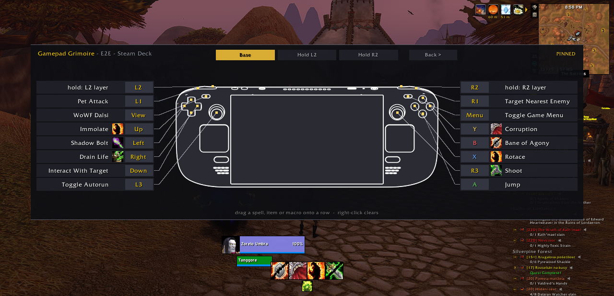
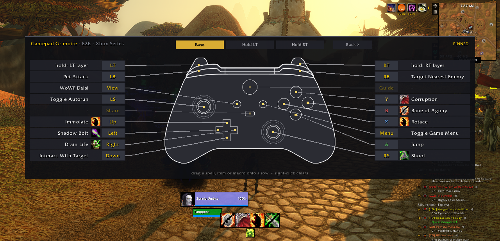

# Gamepad Grimoire

[](https://github.com/sebastianstupak/gamepad-grimoire/actions/workflows/ci.yml)
[](https://github.com/sebastianstupak/gamepad-grimoire/actions/workflows/ci.yml)
[](https://github.com/sebastianstupak/gamepad-grimoire/actions/workflows/ci.yml)
[](https://github.com/sebastianstupak/gamepad-grimoire/actions/workflows/security.yml)
[](https://scorecard.dev/viewer/?uri=github.com/sebastianstupak/gamepad-grimoire)
[](LICENSE)


A World of Warcraft addon for playing with a controller: bind spells, items and
macros to every button, see your binds on a picture of *your* controller, and
share setups with friends.

> Status: early development. Verified in game on WoW: Forever 1.60.1 (Steam Deck)
> by an automated end-to-end test. Not yet released on CurseForge or Wago.

- **Any controller.** Xbox, PlayStation (DualSense), Switch Pro and Steam Deck
  pictures in one consistent line-art style.
- **Never touches your keybinds.** Binds are applied as override bindings owned by
  the addon; disable it and your normal keybinds are back. Changes made in combat
  wait until combat ends.
- **Cheat sheet.** Hold LT or RT to peek at a layer, press LT+R3 to pin the card.
- **Edit in game.** On the pinned card, drag a spell, item or macro onto a button's
  row; right-click clears; click a tab to edit that layer.
- **Layers.** Hold LT or RT for a second and third set of binds.
- **Profiles.** Account-wide, per character and per specialization (switches
  automatically).
- **Share strings.** Export a profile as `!GG1!...` text, import one safely (nothing
  is ever executed; everything is validated).

## Screenshots

In-game screenshots from WoW: Forever on a Steam Deck, taken by the end-to-end test
(`npm run e2e -- --readme`). The profile is a real Affliction warlock setup captured
with `/gg capture`; the same binds are shown on every supported controller.

### Steam Deck: holding LT (L2) to peek at the second layer


### Steam Deck: pinned



### Xbox Series



### PlayStation DualSense


### Nintendo Switch Pro


## Slash commands

Everything can be done with the controller on the pinned card; these are the
keyboard fallback.

| Command | What it does |
| --- | --- |
| `/gg show [lt\|rt]` | Pin or unpin the cheat sheet (or hold LT/RT to peek) |
| `/gg profile` | List profiles (`*` marks the active one) |
| `/gg profile use <name>` | Switch this character to a profile |
| `/gg profile new <name>` | New empty profile |
| `/gg profile copy <name>` | Copy the active profile |
| `/gg profile rename <old> = <new>` | Rename a profile |
| `/gg profile delete <name>` | Delete an unused profile |
| `/gg controller <id\|auto>` | Picture to show: `xbox`, `dualsense`, `switchpro`, `steamdeck` |
| `/gg capture <name>` | New profile from your current controller keybinds |
| `/gg export [profile]` | Share string of a profile (copy box) |
| `/gg import` | Paste a share string to add it as a new profile |
| `/gg scale <0.5-2.5>` | Cheat sheet size |
| `/gg diag` | Check this client (for bug reports) |
| `/gg reload` | Re-apply bindings |

## Roadmap

Controller support (front view, then back view where the device has buttons there):

| Device | Front picture | Back / extra buttons |
| --- | --- | --- |
| Steam Deck (LCD, OLED) | Done | Planned: back view with L4, L5, R4, R5 |
| Xbox Series X/S, Xbox One | Done | |
| Xbox Elite Series 2 | Planned | Planned: back view with paddles P1 to P4 |
| Xbox 360 | Planned | |
| PlayStation DualSense | Done | |
| PlayStation DualSense Edge | Planned | Planned: back view with the two back buttons |
| PlayStation DualShock 4 | Planned (detected already) | |
| Nintendo Switch Pro | Done | |
| Nintendo Switch 2 Pro | Planned | Planned: GL / GR back buttons |
| 8BitDo Pro 2, Ultimate | Planned | Planned: back buttons |
| Steam Controller | Planned | Planned: back grips |
| ROG Ally, Legion Go, MSI Claw | Planned | Planned: back buttons where present |
| Generic gamepad | Planned | |

Features:

- Controller-only setup: pick buttons and actions, switch profiles and options with
  the D-pad and face buttons, no keyboard needed (in progress).
- Back-side view on the card for devices with back buttons, toggled with a button.
- Blizzard's own button glyphs on the card (confirmed available on WoW: Forever).
- Settings in the game's Settings panel.
- Localization.
- Retail and Classic clients in addition to WoW: Forever.
- First release on CurseForge and Wago.

## Development

The addon is Lua 5.1, the dialect the game client runs.

| Area | Tooling |
| --- | --- |
| Format | [StyLua](https://github.com/JohnnyMorganz/StyLua), [ruff](https://docs.astral.sh/ruff/) (`npm run format`) |
| Lint | [luacheck](https://github.com/lunarmodules/luacheck), ruff (`npm run lint`) |
| Types | [lua-language-server](https://luals.github.io) `--check` with LuaLS annotations (`npm run typecheck`) |
| Tests | [busted](https://lunarmodules.github.io/busted/) unit and integration tests, pytest for tools (`npm test`) |
| Coverage | [luacov](https://lunarmodules.github.io/luacov/); CI fails under 90 % (`npm run coverage`) |
| End to end | Real Steam Deck over SSH: install, play, screenshot, verify saved data (`npm run e2e`) |
| Commits | [Conventional Commits](https://www.conventionalcommits.org), checked by commitlint |
| Hooks | [lefthook](https://github.com/evilmartians/lefthook): format and lint on commit, message check, full check on push |
| Security | zizmor, gitleaks, CodeQL, dependency review, OpenSSF Scorecard; actions pinned to SHAs |
| Art | `npm run art` (Pillow and resvg) |
| Release | Tag `vX.Y.Z`, packaged by the [BigWigs packager](https://github.com/BigWigsMods/packager) |

```sh
npm install          # dev tools and git hooks
npm run check        # format, lint, types, tests and coverage (also the pre-push hook)
```

Lua tools (busted, luacov, luacheck, LuaLS) run in a small Docker image (`tools/docker/`)
so they behave the same on every OS and in CI; set `GG_NATIVE_LUA=1` to use local installs.
Python tools: `pip install --require-hashes -r tools/requirements-ci.txt` (hash-locked).

See [docs/ARCHITECTURE.md](docs/ARCHITECTURE.md), [CONTRIBUTING.md](CONTRIBUTING.md),
[AGENTS.md](AGENTS.md) (guide for AI coding agents) and [SECURITY.md](SECURITY.md).

## License

MIT. Controller drawings are derived from AL2009man's Gamepad-Asset-Pack (MIT).
