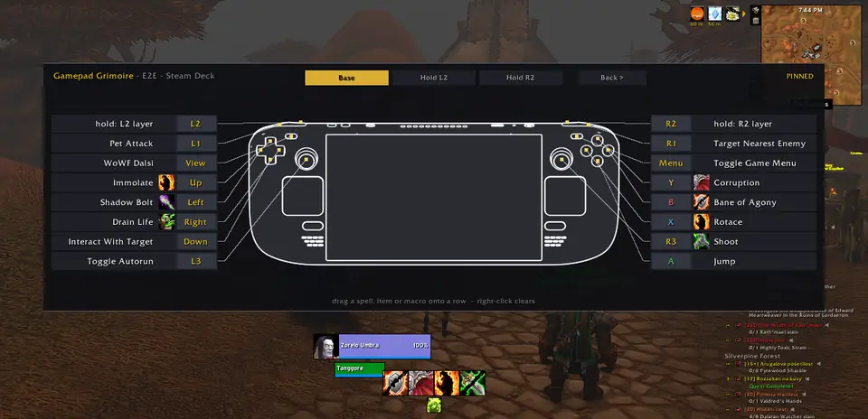
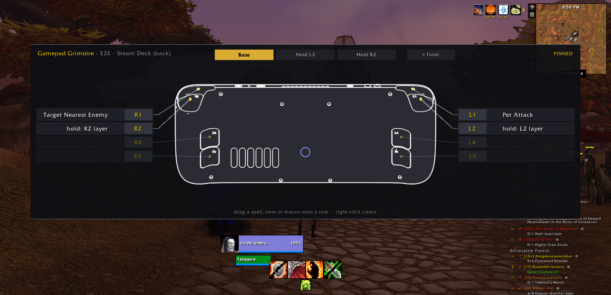
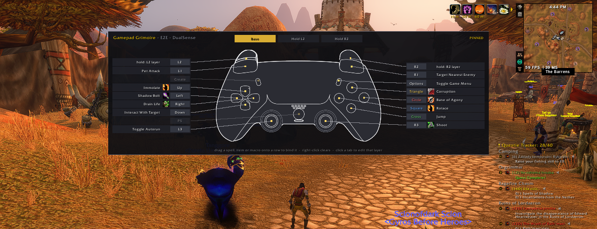
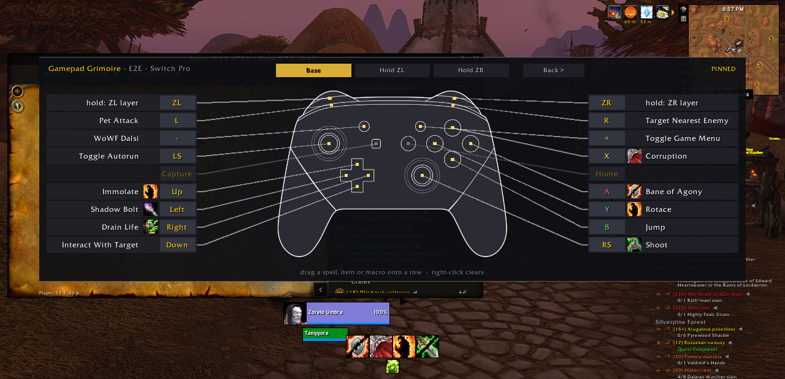

# Gamepad Grimoire

A World of Warcraft addon for playing with a controller: bind spells, items and
macros to every button, see your binds on a picture of *your* controller, and set
it all up without touching the keyboard.

> **Status:** early development — verified in game on WoW: Forever 1.60.1 (Steam Deck)
> by an automated end-to-end test. Not yet on CurseForge/Wago; see [Install](#install).

## Features

- **Any controller** — Xbox, DualSense/DualShock, Switch Pro, 8BitDo, Steam
  Controller, a generic pad, and the Steam Deck / ROG Ally / Legion Go / MSI Claw
  handhelds, each drawn in one line-art style, front and back.
- **Controller-only setup** — press **LT + R3** and bind everything with the pad; no
  keyboard or chat needed.
- **Never touches your keybinds** — binds are override bindings the addon owns;
  disable it and your normal keybinds are back. Combat changes wait for combat to end.
- **Live cheat sheet** — held buttons light up on the card; hold LT/RT to peek at a
  layer (up to three layers).
- **Mouse editing too** — drag a spell, item or macro onto a row; right-click clears.
- **Profiles** — account-wide, per character and per spec (switches automatically).
- **Safe sharing** — export/import a profile as a `!GG1!…` string; nothing is ever
  executed, everything is validated.

## Install

Until the CurseForge/Wago release, install manually:

1. Download the repo (**Code → Download ZIP**, or clone it).
2. Copy the addon into WoW's `Interface/AddOns/` as a folder named **`GamepadGrimoire`**
   — it needs the `.toc`, `src/` and `media/` (the repo without `tools/`, `spec/`
   and `docs/`).
3. Enable **Gamepad Grimoire** on the character screen.

On a Steam Deck, [wow-steamdeck-setup](https://github.com/sebastianstupak/wow-steamdeck-setup)
has an `install-addon.sh` that pushes an addon over SSH.

## Usage

Press **LT + R3** in game to open the setup, or use `/gg` commands — the handy ones:

| Command | What it does |
| --- | --- |
| `/gg setup` | Open the controller setup (same as LT+R3) |
| `/gg show` · `/gg hide` | Pin or hide the cheat sheet |
| `/gg controller <id\|auto>` | Which controller picture to show |
| `/gg profile use <name>` | Switch this character to a profile |
| `/gg export` · `/gg import` | Share a profile as text |

`/gg help` lists every command.

## Screenshots

<table>
<tr><td width="50%"><b>Steam Deck, front</b> </td>
<td width="50%"><b>Back: L4 / L5 / R4 / R5 grips</b> </td></tr>
</table>

The card draws whichever controller you plug in:

<table>
<tr>
<td width="33%"><b>Xbox</b> </td>
<td width="33%"><b>DualSense</b> </td>
<td width="33%"><b>Switch Pro</b> </td>
</tr>
</table>

## Roadmap

Every controller above has a front and back picture. Still to come:

- Steam Deck / handheld **back grips** that Steam Input turns into keys — bind those
  keys too (today the game can't see them as controller buttons).
- Pasting share strings with the controller; Blizzard's own button glyphs on the card.
- Localization; Retail and Classic clients; first CurseForge/Wago release.

## Contributing

Pull requests welcome. See **[CONTRIBUTING.md](CONTRIBUTING.md)** for the dev setup,
tooling and commit conventions, and **[SECURITY.md](SECURITY.md)** to report a
vulnerability.

## License

Code is **MIT** ([LICENSE](LICENSE)). Controller pictures are licensed per file —
Valve official CAD (Steam Deck / Controller, CC BY-NC-SA), a community DualSense model
(CC BY 4.0), models built for this project (MIT), and a traced Switch Pro (MIT); full
credits in [media/controllers/CREDITS.md](media/controllers/CREDITS.md). Not made,
endorsed or supported by Blizzard or Valve.
