# Gamepad Grimoire

[](https://github.com/sebastianstupak/gamepad-grimoire/actions/workflows/ci.yml)
[](https://github.com/sebastianstupak/gamepad-grimoire/actions/workflows/ci.yml)
[](https://github.com/sebastianstupak/gamepad-grimoire/actions/workflows/ci.yml)
[](https://github.com/sebastianstupak/gamepad-grimoire/actions/workflows/security.yml)
[](https://scorecard.dev/viewer/?uri=github.com/sebastianstupak/gamepad-grimoire)
[](LICENSE)


A World of Warcraft addon for playing with a controller: bind spells, items and
macros to every button, see your binds on a picture of *your* controller, and
share setups with friends.

> Status: early development. Verified in game on WoW: Forever 1.60.1 (Steam Deck)
> by an automated end-to-end test. Not yet released on CurseForge or Wago.

- **Any controller.** Xbox Series, Xbox 360, DualSense, DualShock 4, Switch Pro,
  8BitDo Pro 2, Steam Controller, a generic gamepad, and the Steam Deck, ROG Ally,
  Legion Go and MSI Claw handhelds, in one consistent line-art style.
- **Never touches your keybinds.** Binds are applied as override bindings owned by
  the addon; disable it and your normal keybinds are back. Changes made in combat
  wait until combat ends.
- **Set up with the controller only.** Press LT+R3: move over the buttons with the
  D-pad (or just press the button you want), A picks a spell, macro, item or game
  action for it, X clears it, LB / RB switch layers, View shows the back of the
  controller, Y opens profiles and options, B closes. Profiles are named with an
  on-screen keyboard. No keyboard or chat needed.
- **Front and back.** Back views show the Steam Deck's L4 / L5 / R4 / R5, Xbox Elite
  paddles and DualSense Edge back buttons (View turns the card around). Whether
  their presses reach the game depends on the controller and Steam Input; see the
  roadmap.
- **Live highlight.** Held buttons light up on the card, so you can check what is where.
- **Cheat sheet.** Hold LT or RT to peek at a layer; the card sizes itself to the screen.
- **Mouse editing too.** On the open card, drag a spell, item or macro onto a row;
  right-click clears.
- **Layers.** Hold LT or RT for a second and third set of binds.
- **Profiles.** Account-wide, per character and per specialization (switches
  automatically).
- **Share strings.** Export a profile as `!GG1!...` text, import one safely (nothing
  is ever executed; everything is validated).

## The controller pictures

Every supported controller in one line-art style, **front and back** side by side.
Eleven are rendered from 3D models (tilted slightly from above); the Switch Pro is traced vector art.

### Rendered from Valve's official CAD

Licensed CC BY-NC-SA 4.0 like the model; credited to Valve. Not endorsed by Valve.

<table>
<tr><td><b>Steam Deck</b>: front and back<br>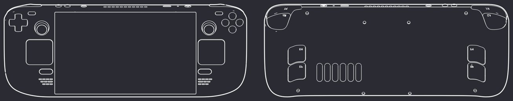</td></tr>
<tr><td><b>Steam Controller (2026)</b>: front and back<br>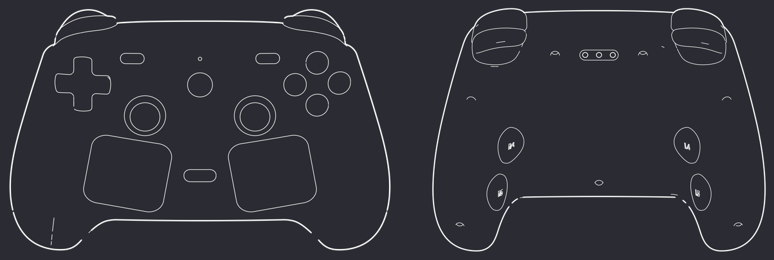</td></tr>
</table>

### Rendered from community 3D models

Each CC BY 4.0, credited to its author in [media/controllers/CREDITS.md](media/controllers/CREDITS.md).

<table>
<tr><td><b>Xbox (Elite model)</b>: front and back<br>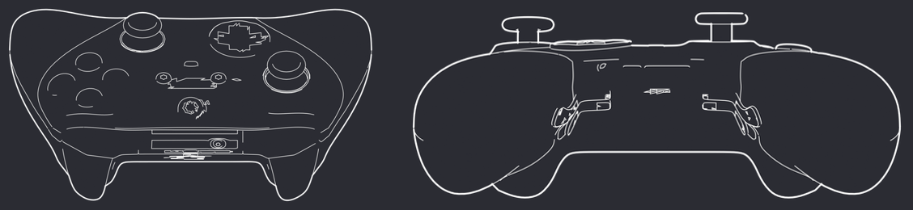</td></tr>
<tr><td><b>DualSense</b>: front and back<br>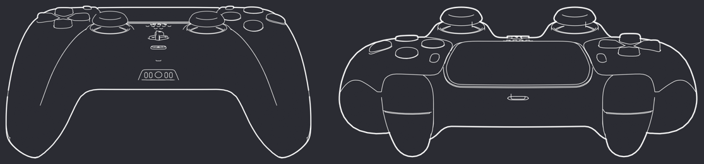</td></tr>
<tr><td><b>DualShock 4</b>: front and back<br>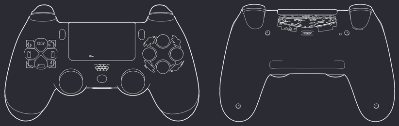</td></tr>
<tr><td><b>Xbox 360</b>: front and back<br>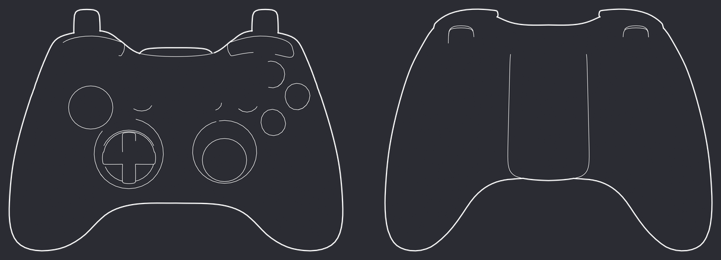</td></tr>
</table>

### Modelled for this project

Parametric 3D models (`tools/art/model.py`), MIT; simplified impressions, not exact replicas.

<table>
<tr><td><b>ROG Ally</b>: front and back<br>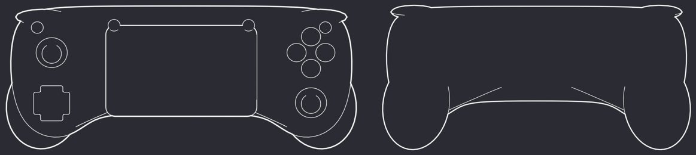</td></tr>
<tr><td><b>Lenovo Legion Go</b>: front and back<br>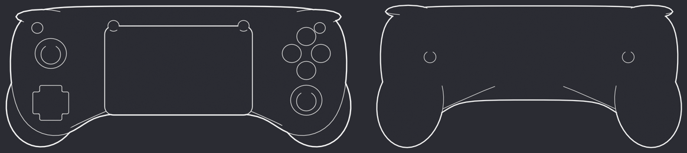</td></tr>
<tr><td><b>MSI Claw</b>: front and back<br>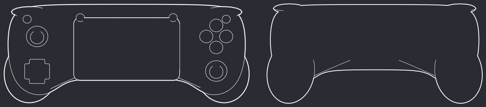</td></tr>
<tr><td><b>8BitDo Pro 2</b>: front and back<br>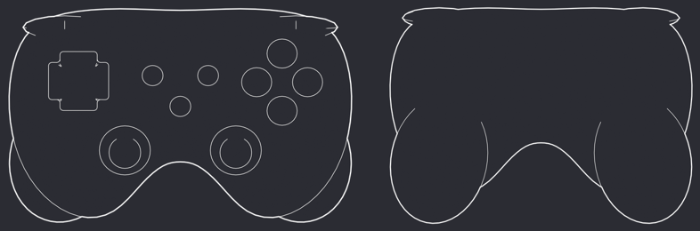</td></tr>
<tr><td><b>Generic gamepad</b>: front and back<br>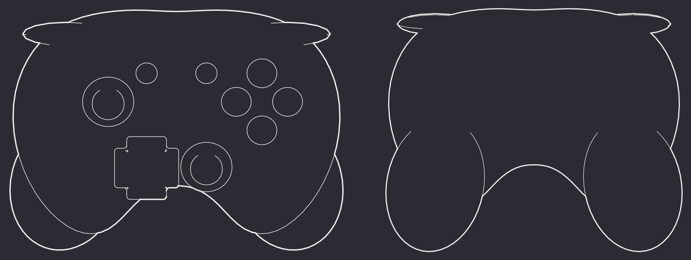</td></tr>
</table>

### Traced vector art

From AL2009man's Gamepad-Asset-Pack (MIT).

<table>
<tr><td><b>Switch Pro</b>: front and back<br>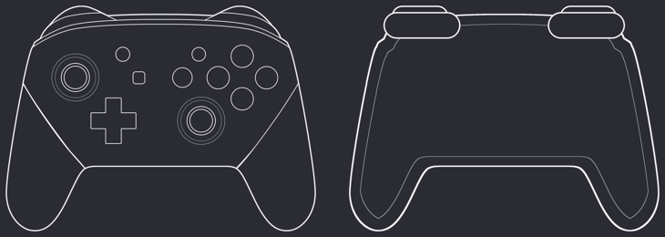</td></tr>
</table>
## Screenshots

In-game screenshots from WoW: Forever on a Steam Deck (1280x800), taken by the
end-to-end test (`npm run e2e -- --readme`). The profile is a real Affliction
warlock setup captured with `/gg capture`.

### Steam Deck: front and back

<table>
<tr><td width="50%"><b>Front</b><br></td>
<td width="50%"><b>Back: R4 bound in the controller setup</b><br>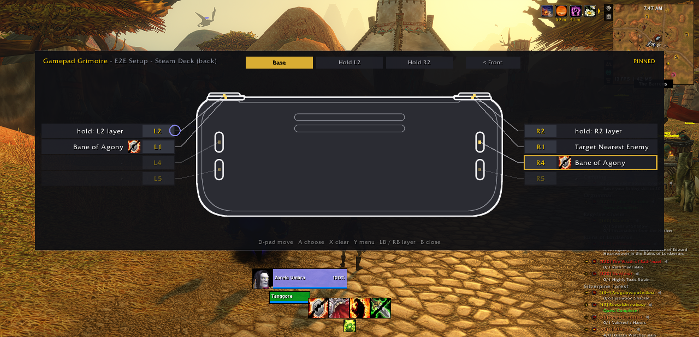</td></tr>
</table>

View (or `/gg flip`) turns the card around.

> **Steam Deck back grips:** with Steam Input on (the default), SteamOS keeps
> L4 / L5 / R4 / R5 and sends the game keys or Steam actions instead, so binds on
> them do not fire yet. When the game reports no back buttons, the back view says
> so. See the roadmap.

### Holding L2 to peek at the second layer

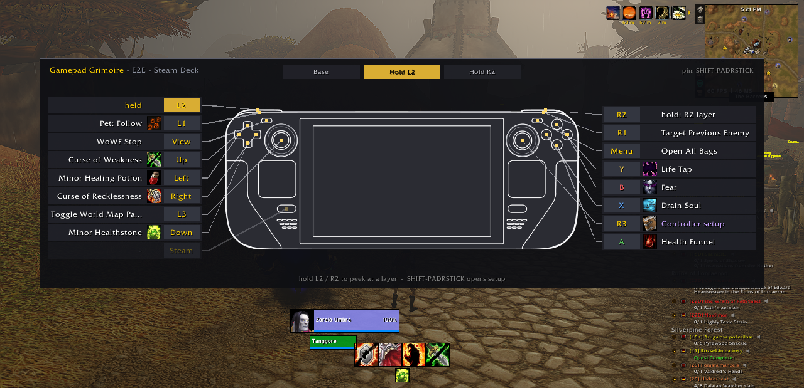

### Controller setup: pick a button, then what it does

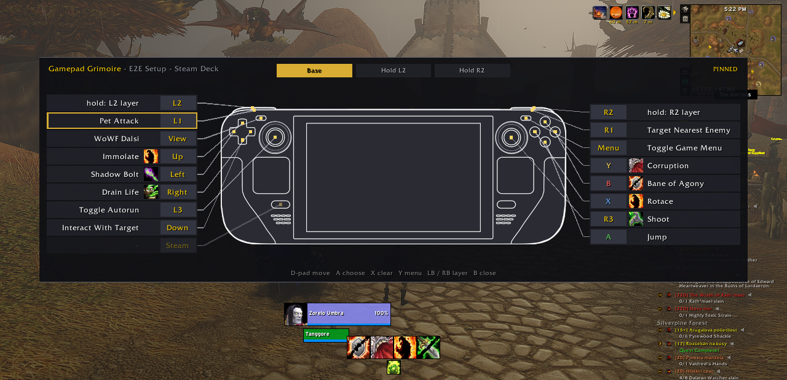

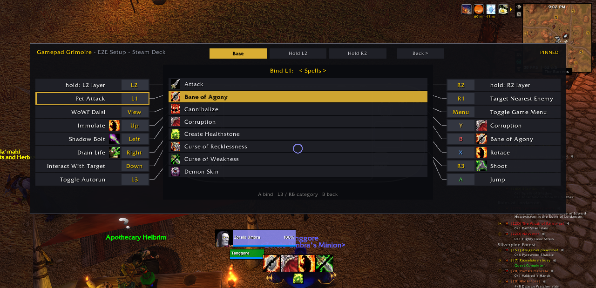

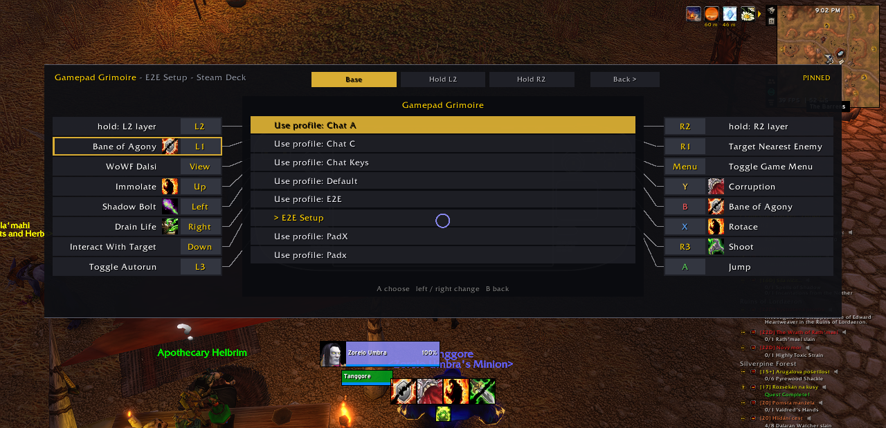

### Held buttons light up

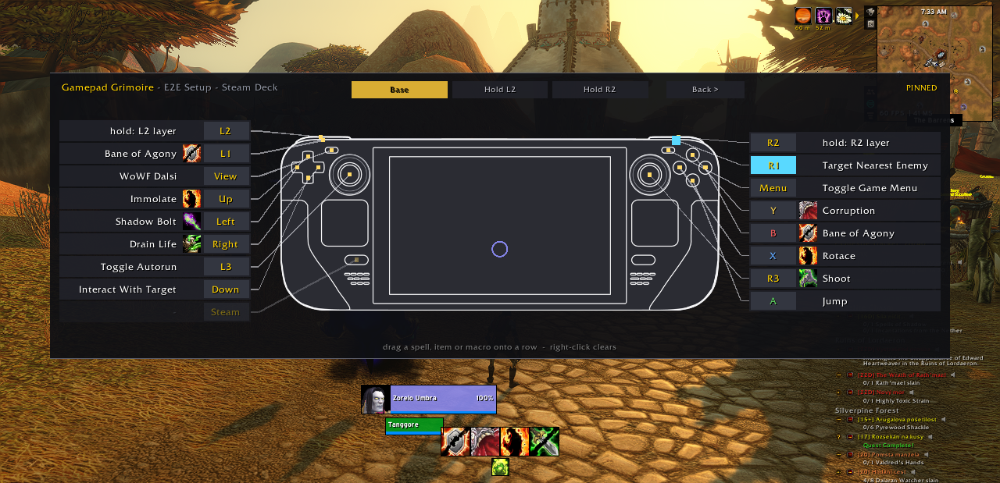

For each controller's picture, front and back, see
[The controller pictures](#the-controller-pictures) above. The in-game shots on
this page are refreshed by the end-to-end test; they lag the newest pictures until
the next Steam Deck run.

## Slash commands

Everything can be done with the controller (LT+R3 opens the setup); these are
the keyboard fallback.

| Command | What it does |
| --- | --- |
| `/gg setup` | Controller setup (same as LT+R3) |
| `/gg show [base\|lt\|rt]` | Pin or unpin the cheat sheet; with a layer, pin it on that layer (or hold LT/RT to peek) |
| `/gg hide` | Hide the pinned cheat sheet |
| `/gg flip` | Turn the card around: front or back of the controller (View in the setup) |
| `/gg profile` | List profiles (`*` marks the active one) |
| `/gg profile use <name>` | Switch this character to a profile |
| `/gg profile new <name>` | New empty profile |
| `/gg profile copy <name>` | Copy the active profile |
| `/gg profile rename <old> = <new>` | Rename a profile |
| `/gg profile delete <name>` | Delete an unused profile |
| `/gg controller <id\|auto>` | Picture to show: `xbox`, `xbox360`, `dualsense`, `dualshock4`, `switchpro`, `8bitdo`, `steamcontroller`, `generic`, `steamdeck`, `rogally`, `legiongo`, `msiclaw` |
| `/gg capture <name>` | New profile from your current controller keybinds |
| `/gg export [profile]` | Share string of a profile (copy box) |
| `/gg import` | Paste a share string to add it as a new profile |
| `/gg scale <0.5-2.5\|auto>` | Cheat sheet size (automatic by default) |
| `/gg diag` | Check this client (for bug reports) |
| `/gg reload` | Re-apply bindings |

## Roadmap

Controller support (front view, then back view where the device has buttons there):

| Device | Front picture | Back buttons drawn | Back buttons reach the game |
| --- | --- | --- | --- |
| Steam Deck (LCD, OLED) | Done | L4, L5, R4, R5 | No with Steam Input (they become keys); planned: bind them as keys |
| Xbox Series X/S, Xbox One | Done | (triggers and bumpers) | |
| Xbox Elite Series 2 | Uses the Xbox picture | P1 to P4 | Unverified (a virtual Elite's paddles arrive as face buttons) |
| Xbox 360 | Done | (triggers and bumpers) | |
| PlayStation DualSense | Done | (triggers and bumpers) | |
| PlayStation DualSense Edge | Uses the DualSense picture | The two back buttons | Unverified |
| PlayStation DualShock 4 | Done | (triggers and bumpers) | |
| Nintendo Switch Pro | Done | (triggers and bumpers) | |
| Nintendo Switch 2 Pro | Planned | Planned: GL / GR | |
| 8BitDo Pro 2 | Done | P1, P2 | Unverified |
| 8BitDo Ultimate | Planned | | |
| Steam Controller (2026) | Done (Valve CAD) | Four back buttons | Unverified |
| ROG Ally / Ally X | Done | M1, M2 | Unverified |
| Lenovo Legion Go | Done | M2, M3, Y1, Y2 | Unverified |
| MSI Claw | Done | M1, M2 | Unverified |
| Generic gamepad | Done | (triggers and bumpers) | |
| Joy-Cons, arcade sticks | Planned | | |

Features:

- Back grips that Steam Input turns into keys (Steam Deck): bind those keys too.
- Pasting share strings with the controller (profiles are already named with the
  on-screen keyboard).
- Blizzard's own button glyphs on the card (confirmed available on WoW: Forever).
- Localization.
- Retail and Classic clients in addition to WoW: Forever.
- First release on CurseForge and Wago.

## Development

The addon is Lua 5.1, the dialect the game client runs.

| Area | Tooling |
| --- | --- |
| Format | [StyLua](https://github.com/JohnnyMorganz/StyLua), [ruff](https://docs.astral.sh/ruff/) (`npm run format`) |
| Lint | [luacheck](https://github.com/lunarmodules/luacheck), ruff (`npm run lint`) |
| Types | [lua-language-server](https://luals.github.io) `--check` with LuaLS annotations (`npm run typecheck`) |
| Tests | [busted](https://lunarmodules.github.io/busted/) unit, integration and end-to-end specs (every chat command, controller-only and mouse journeys against a simulated client), seeded fuzzing of share strings, pytest for tools (`npm test`) |
| Coverage | [luacov](https://lunarmodules.github.io/luacov/); CI fails under 90 % (`npm run coverage`) |
| End to end | Real Steam Deck over SSH: install, play, screenshot, verify saved data (`npm run e2e`) |
| Commits | [Conventional Commits](https://www.conventionalcommits.org), checked by commitlint |
| Hooks | [lefthook](https://github.com/evilmartians/lefthook): format and lint on commit, message check, full check on push |
| Security | zizmor, gitleaks, CodeQL, dependency review, OpenSSF Scorecard; actions pinned to SHAs |
| Art | `npm run art` (Pillow and resvg) |
| Release | Tag `vX.Y.Z`, packaged by the [BigWigs packager](https://github.com/BigWigsMods/packager) |

```sh
npm install          # dev tools and git hooks
npm run check        # format, lint, types, tests and coverage (also the pre-push hook)
```

Lua tools (busted, luacov, luacheck, LuaLS) run in a small Docker image (`tools/docker/`)
so they behave the same on every OS and in CI; set `GG_NATIVE_LUA=1` to use local installs.
Python tools: `pip install --require-hashes -r tools/requirements-ci.txt` (hash-locked).

See [docs/ARCHITECTURE.md](docs/ARCHITECTURE.md), [CONTRIBUTING.md](CONTRIBUTING.md),
[AGENTS.md](AGENTS.md) (guide for AI coding agents) and [SECURITY.md](SECURITY.md).

## License

The code is MIT. Controller pictures are licensed per file, see
[media/controllers/CREDITS.md](media/controllers/CREDITS.md):

- The Steam Deck and Steam Controller pictures are rendered from Valve's official
  CAD ([Deck](https://gitlab.steamos.cloud/SteamDeck/hardware),
  [Controller](https://gitlab.steamos.cloud/SteamHardware/SteamController)) and are
  licensed [CC BY-NC-SA 4.0](https://creativecommons.org/licenses/by-nc-sa/4.0/)
  like those models. Gamepad Grimoire is not made, endorsed or supported by Valve.
- The Xbox, DualSense, DualShock 4 and Xbox 360 pictures are rendered from
  community 3D models on Sketchfab, each [CC BY 4.0](https://creativecommons.org/licenses/by/4.0/)
  and credited to its author in [media/controllers/CREDITS.md](media/controllers/CREDITS.md):
  Xbox Elite by Rusfort, DualSense by AHarmlessPotato, DualShock 4 by shaielwolf,
  Xbox 360 by Harpiart.
- The ROG Ally, Legion Go, MSI Claw, 8BitDo Pro 2 and generic pad are 3D models
  built for this project (`tools/art/model.py`) and are MIT; simplified line-art
  impressions, not exact replicas.
- The Switch Pro picture is derived from AL2009man's Gamepad-Asset-Pack (MIT).
