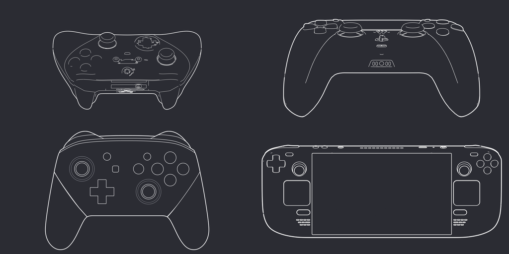

# Gamepad Grimoire

A World of Warcraft addon for playing with a controller: bind spells, items and
macros to every button, see your binds on a picture of *your* controller, and
share setups as text.

> Status: early development - everything below works in unit and integration
> tests; the first in-game end-to-end run on a Steam Deck is next.

- **Any controller** – Xbox, PlayStation (DualSense), Switch Pro and Steam Deck
  pictures in one consistent line-art style; detected automatically, or chosen.
- **Never touches your keybinds** – binds are applied as override bindings owned by
  the addon; disable it and your normal keybinds are back. Changes made in combat
  wait until combat ends.
- **Cheat sheet** – hold LT/RT to peek at a layer, or pin the card (LT+R3, `/gg show`).
- **Edit in game** – on the pinned card, drag a spell, item or macro onto a button's row;
  right-click clears; click a tab to edit that layer.
- **Layers** – hold LT or RT for a second and third set of binds.
- **Profiles** – account-wide, per character and per specialization (switches
  automatically).
- **Share strings** – export a profile as `!GG1!…` text, import one safely (nothing
  is ever executed; everything is validated).



*Controller pictures, generated from vector sources by `npm run art`. In-game
screenshots of the cheat sheet are produced by `npm run e2e -- --readme`.*

## Commands

```
/gg profile                  list profiles (* = active)
/gg profile use <name>       switch this character to a profile
/gg profile new <name>       new empty profile
/gg profile copy <name>      copy the active profile
/gg controller <id|auto>     xbox, dualsense, switchpro, steamdeck
/gg show [lt|rt]             pin / unpin the cheat sheet (or hold LT/RT to peek)
/gg capture <name>           profile from your current controller keybinds
/gg export [profile]         share string (copy box)
/gg import                   paste a share string -> new profile
/gg diag                     check this client (for bug reports)
/gg reload                   re-apply bindings
```

## Development

The addon is Lua 5.1 (the client's dialect). Tooling:

| | |
|---|---|
| Format | [StyLua](https://github.com/JohnnyMorganz/StyLua), [ruff](https://docs.astral.sh/ruff/) (`npm run format`) |
| Lint | [luacheck](https://github.com/lunarmodules/luacheck), ruff (`npm run lint`) |
| Types | [lua-language-server](https://luals.github.io) `--check` with LuaLS annotations (`npm run typecheck`) |
| Tests | [busted](https://lunarmodules.github.io/busted/) unit + integration, pytest for tools (`npm test`) |
| Coverage | [luacov](https://lunarmodules.github.io/luacov/), CI fails under 90 % (`npm run coverage`) |
| End to end | real Steam Deck over SSH: install, play, screenshot, verify saved data (`npm run e2e`) |
| Commits | [Conventional Commits](https://www.conventionalcommits.org), checked by commitlint |
| Hooks | [lefthook](https://github.com/evilmartians/lefthook) – format/lint on commit, message check, tests on push |
| Art | `python tools/art/build.py` (Pillow + resvg) |
| Release | tag `vX.Y.Z` → [BigWigs packager](https://github.com/BigWigsMods/packager) |

```sh
npm install          # dev tools + git hooks
npm run check        # format, lint, types, tests + coverage (also the pre-push hook)
```

Lua tools (busted, luacov, luacheck, LuaLS) run in a small Docker image (`tools/docker/`)
so they behave the same on every OS and in CI; set `GG_NATIVE_LUA=1` to use local installs.
Python tools need `pip install -r tools/art/requirements.txt pytest ruff`.

See [docs/ARCHITECTURE.md](docs/ARCHITECTURE.md) and [CONTRIBUTING.md](CONTRIBUTING.md).

## License

MIT. Controller drawings are derived from AL2009man's Gamepad-Asset-Pack (MIT).
